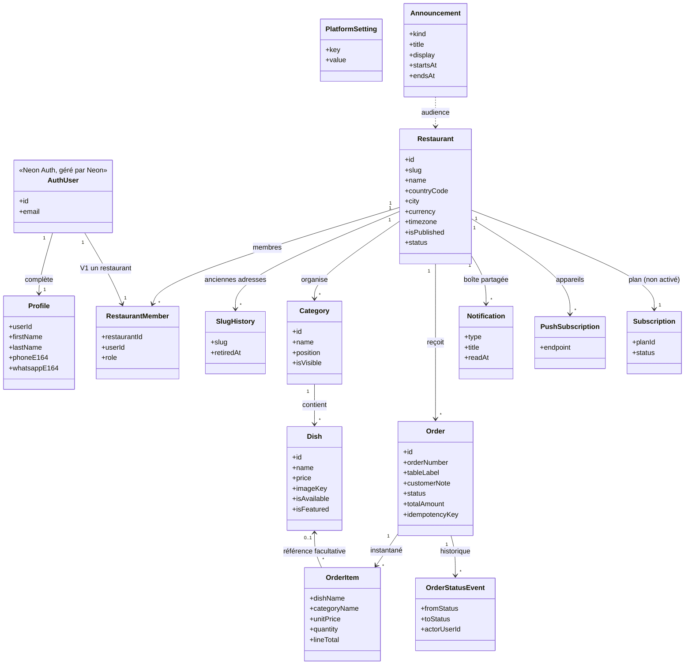
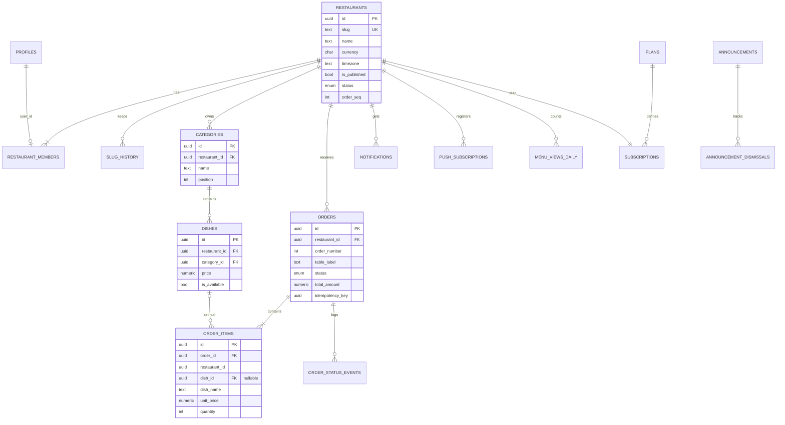
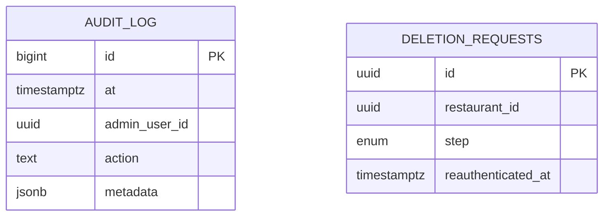
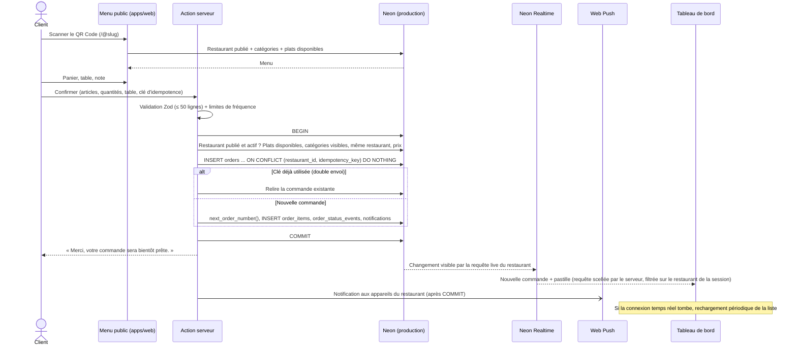
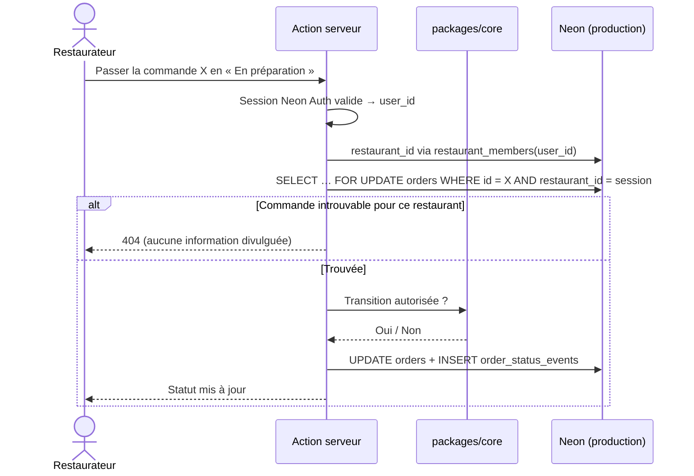
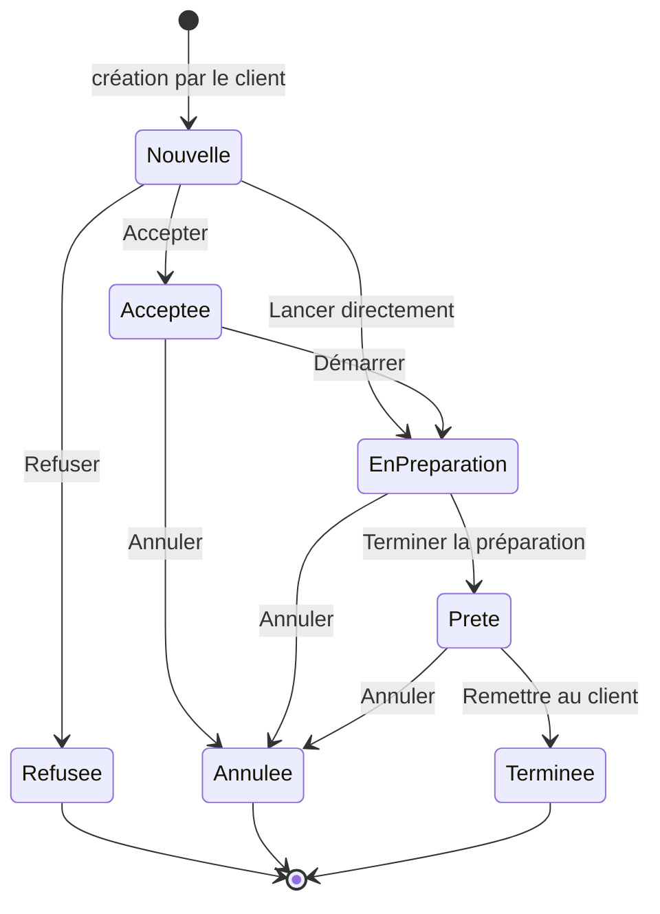

# RESTIO — MODÉLISATION UML

## 1. Objectif du document

Ce document présente une première modélisation UML de Restio, plateforme SaaS de gestion de menus numériques et de commandes pour les restaurants.

Il a pour objectif de faciliter la compréhension de l'architecture fonctionnelle, des principales entités métier et des interactions entre les différents composants de l'application.

Les diagrammes présentés constituent une base de travail indicative.

**Ils ne représentent pas une architecture définitive et ne doivent pas être considérés comme des contraintes techniques immuables.**

L'agent de développement doit analyser ce document, le confronter aux autres documents du projet et à l'architecture réellement existante, puis le valider, le corriger, le compléter ou le simplifier selon les besoins réels.

## 2. Instructions de modélisation

Avant toute utilisation de ces diagrammes :

1. Lire `PROJECT.md` pour comprendre le fonctionnement global de Restio.
2. Lire `CLAUDE.md` et les directives globales de sécurité.
3. Consulter `DESIGN.md` pour comprendre les contraintes de conception.
4. Examiner l'architecture, les technologies et les fonctionnalités existantes.
5. Vérifier les entités, relations et processus réellement nécessaires.
6. Analyser les éventuelles incohérences ou informations manquantes dans les diagrammes.

### Règles importantes

- Ne pas considérer les diagrammes proposés comme exhaustifs.
- Ne pas inventer des entités, attributs, relations ou fonctionnalités sans justification.
- Ne pas supprimer une relation nécessaire au fonctionnement du produit.
- Adapter les diagrammes à la technologie et à l'architecture réellement utilisées.
- Préserver les fonctionnalités existantes.
- Privilégier une architecture simple, cohérente, sécurisée et évolutive.
- Mettre à jour les diagrammes lorsque des décisions techniques ou fonctionnelles importantes évoluent.

Si une information nécessaire manque, rechercher d'abord si elle est disponible dans les autres documents ou dans le code. En cas d'incertitude importante, demander une clarification.

## 3. Diagramme des cas d'utilisation

> Mis à jour le 3 novembre 2026 : Neon Auth remplace Clerk, ajout de l'administrateur, paiements reportés.

```mermaid
flowchart TB
    Client([Client du restaurant])
    Restaurateur([Restaurateur])
    Admin([Administrateur Restio])
    AuthResto([Neon Auth - instance restaurateurs])
    AuthAdmin([Neon Auth - instance administration])

    subgraph PUBLIC["Menu public - restio-app.com/@slug"]
        UC1["Consulter le menu"]
        UC3["Composer un panier"]
        UC4["Passer une commande"]
        UC5["Recevoir une confirmation"]
    end

    subgraph APP["Application - app.restio-app.com"]
        UC6["S'inscrire / se connecter"]
        UC15["Compléter profil et restaurant"]
        UC7["Gérer les commandes"]
        UC8["Gérer catégories et plats"]
        UC10["Générer QR Code et supports"]
        UC11["Consulter les statistiques"]
        UC12["Configurer restaurant et apparence"]
        UC14["Recevoir les notifications"]
    end

    subgraph ADMIN["Administration - admin.restio-app.com"]
        UA1["Se connecter (aucune inscription)"]
        UA2["Superviser restaurants et activité"]
        UA3["Suspendre / supprimer un restaurant"]
        UA4["Modifier les paramètres globaux et pixels"]
        UA5["Publier annonces et tutoriels"]
        UA6["Consulter le journal d'audit"]
    end

    Client --> UC1 & UC3 & UC4 & UC5
    Restaurateur --> UC6 & UC15 & UC7 & UC8 & UC10 & UC11 & UC12 & UC14
    Admin --> UA1 & UA2 & UA3 & UA4 & UA5 & UA6
    AuthResto --> UC6
    AuthAdmin --> UA1
```



### Points vérifiés

- Le client commande sans compte.
- Le restaurateur n'accède qu'à son établissement (filtrage serveur par `restaurant_members`).
- Les deux instances Neon Auth sont sur deux branches distinctes : aucun compte restaurateur n'existe côté administration.
- Le paiement d'abonnement n'est pas un cas d'utilisation de la V1.

## 4. Diagramme de classes

Le détail des colonnes, types et contraintes est dans `DATABASE.md`. Ce diagramme montre les entités et leurs relations.



### Corrections par rapport à la version initiale

- `clerkId` supprimé : l'identifiant vient de Neon Auth et n'est relié par aucune clé étrangère au schéma géré par Neon.
- Le prénom, le nom, le téléphone et le WhatsApp sont dans `Profile`, distincts entre eux.
- `RestaurantMember` remplace le lien direct utilisateur → restaurant : il prépare les collaborateurs sans les développer.
- `Dish` porte aussi `restaurantId` : clés composites qui empêchent tout mélange entre restaurants.
- `OrderItem` conserve nom, catégorie et prix au moment de la commande ; la référence au plat devient facultative.
- `Payment` est retiré tant qu'aucun prestataire n'est choisi. `Subscription` est conservé mais non activé.
- `PlatformSetting` et `Announcement` sont ajoutés : écrits par l'administration, lus par l'application.

## 5. Diagramme entité-relation (ERD)

### 5.1. Base métier (`production` / `neondb`)



### 5.2. Base d'administration (`admin` / `restio_admin`)



Les deux bases n'ont aucune clé étrangère entre elles : elles sont sur deux branches différentes. Le lien `deletion_requests.restaurant_id` est vérifié par le serveur d'administration.

## 6. Diagrammes de séquence

### 6.1. Parcours de commande du client



### 6.2. Changement de statut d'une commande



### 6.3. Suppression d'un restaurant par l'administration

```mermaid
sequenceDiagram
    actor Admin
    participant AdminApp as apps/admin
    participant AdminDB as Neon (admin)
    participant ProdDB as Neon (production)

    Admin->>AdminApp: Étape 1 - confirmer le compte visé
    AdminApp->>AdminDB: INSERT deletion_requests (confirmed)
    Admin->>AdminApp: Étape 2 - ressaisir le nom du restaurant
    AdminApp->>AdminDB: step = typed
    Admin->>AdminApp: Étape 3 - réauthentification + validation finale
    AdminApp->>AdminDB: Vérifier demande non expirée et réauthentification récente (vérifiée par le serveur)
    AdminApp->>AdminDB: audit_log (intention)
    AdminApp->>ProdDB: Transaction : DELETE restaurants (cascade), profiles, announcement_dismissals
    AdminApp->>AdminDB: step = executed + audit_log (résultat)
    Note over AdminApp: Fichiers du stockage supprimés ensuite ; échec journalisé et rejoué
    Note over Admin: Identité Neon Auth supprimée par le propriétaire (console ou CLI), aucune clé d'API Neon dans l'application
```

Le paiement d'abonnement (ancienne séquence 6.2) est retiré tant qu'aucun prestataire n'est choisi.

## 7. Diagramme d'états-transitions des commandes



### Règles validées

- Seuls les membres du restaurant modifient les statuts ; le client ne peut ni annuler ni modifier une commande envoyée (V1).
- Ajout de `Nouvelle → En préparation` : dans un petit restaurant, accepter puis préparer est souvent un seul geste.
- Ajout de `Prête → Annulée` : client parti avant d'être servi.
- Toute autre transition est rejetée côté serveur.
- Chaque transition crée une ligne `order_status_events` (horodatage et auteur).
- Les commandes terminées, refusées ou annulées restent consultables.

## 8. Validation et évolution de la modélisation

Les diagrammes de ce document constituent une proposition initiale de modélisation.

L'agent de développement doit effectuer une véritable vérification de cohérence avant de les utiliser comme référence d'implémentation.

Il doit notamment :

1. Comparer les diagrammes avec la présentation globale de Restio.
2. Vérifier que tous les besoins fonctionnels sont représentés.
3. Identifier les entités, relations, attributs et processus manquants.
4. Vérifier la cohérence entre le diagramme de classes et le diagramme entité-relation.
5. Vérifier que les séquences respectent les règles de sécurité et les responsabilités frontend/backend.
6. Vérifier que les états et transitions correspondent aux règles métier.
7. Identifier les éléments inutiles ou redondants.
8. Améliorer librement les diagrammes lorsque cela est justifié.

Si une représentation ne correspond pas à l'architecture réelle, elle doit être corrigée plutôt que de forcer le développement à suivre un modèle inadapté.

Il n'est pas nécessaire d'ajouter d'autres diagrammes UML si ceux-ci n'apportent aucune valeur réelle au projet.

Toute évolution importante doit être documentée afin que les diagrammes restent cohérents avec le code et la structure réelle de Restio.

## 9. Règle finale

**La qualité et l'exactitude de la modélisation priment sur le nombre de diagrammes.**

L'objectif n'est pas de produire une documentation UML volumineuse, mais de disposer d'une représentation claire, fiable et exploitable du fonctionnement de Restio.

Ces diagrammes doivent aider au développement, prévenir les incohérences et faciliter la maintenance future de la plateforme, sans imposer de complexité inutile.